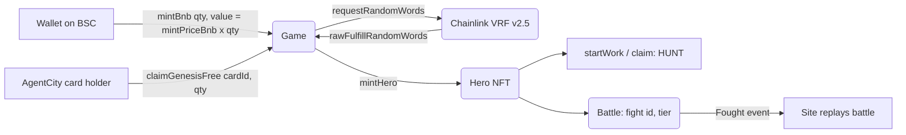

# CITY HUNTERS — Smart Contracts

On-chain hero game on BNB Smart Chain. Mint heroes, send them to work for HUNT, and battle other hunters.

- Website: https://cityhunters.io
- X: https://x.com/CityHunters_X
- Chain: BNB Smart Chain (chainId 56)

## Mainnet deployments (all verified on BscScan)

| Contract | Address |
|---|---|
| HUNT Token | [`0x03353e0Dfc5123de796417f98437e45B48d88146`](https://bscscan.com/address/0x03353e0Dfc5123de796417f98437e45B48d88146#code) |
| Hero NFT | [`0xF10d29ea0480AC292a616Ff3692fCd27961A3Aa2`](https://bscscan.com/address/0xF10d29ea0480AC292a616Ff3692fCd27961A3Aa2#code) |
| Game | [`0x286F24d6BA59F4dE3fEb04aC41aBCa12e422d956`](https://bscscan.com/address/0x286F24d6BA59F4dE3fEb04aC41aBCa12e422d956#code) |
| Battle | [`0xE985199d7cDf4a8211b07Ab7C57f3E7e40c5a25A`](https://bscscan.com/address/0xE985199d7cDf4a8211b07Ab7C57f3E7e40c5a25A#code) |
| Agent City | [`0x04a9F5a5f6409DAd7eD9eC54bBACF89663651cD7`](https://bscscan.com/address/0x04a9F5a5f6409DAd7eD9eC54bBACF89663651cD7#code) |
| Referral | [`0xF4F3a0045fB2Bfc1F5cB37E20fb2fdEbDe781DA7`](https://bscscan.com/address/0xF4F3a0045fB2Bfc1F5cB37E20fb2fdEbDe781DA7#code) |
| Genesis Draw | [`0x5A059D831F9208f4435eD7C490EbdB078F909528`](https://bscscan.com/address/0x5A059D831F9208f4435eD7C490EbdB078F909528#code) |
| Whitelist Mint | [`0x0126558a6D93F92E3f1D6195D9BDd863cddf7394`](https://bscscan.com/address/0x0126558a6D93F92E3f1D6195D9BDd863cddf7394#code) |
| Official Agent | [`0x1E5F0896F6d568157fc6f71C29Cb7833d1C41D0f`](https://bscscan.com/address/0x1E5F0896F6d568157fc6f71C29Cb7833d1C41D0f#code) |
| Team Vesting | [`0x6566092A7Baa5DfCC3699C7CC6B6D6786Ae53a9e`](https://bscscan.com/address/0x6566092A7Baa5DfCC3699C7CC6B6D6786Ae53a9e#code) |

Full list incl. Chainlink config: [`deployments/mainnet.json`](deployments/mainnet.json). ABIs: [`deployments/abi`](deployments/abi).

Genesis sale: starts 2026-10-28T12:00:00Z, ends 2026-10-31T12:00:00Z (UTC).

## Repository layout

- `src/` core contracts (Hero, HuntToken, Game, Battle, Referral, OfficialAgent) and mocks for testing
- `src/mainnet/` mainnet versions (GameMainnet, BattleMainnet, ReferralMainnet, GenesisDraw, WhitelistMint, OfficialAgentMainnet)
- `test/` Foundry tests
- `script/` Foundry deployment scripts

## BNB Chain integration

- Network: BNB Smart Chain mainnet, chainId 56 (`deployments/mainnet.json`)
- Chainlink VRF v2.5 coordinator `0xd691f04bc0C9a24Edb78af9E005Cf85768F694C9` (native-paid subscription) for hero mints and merges
- Chainlink BNB/USD feed `0x0567F2323251f0Aab15c8dFb1967E4e8A7D42aeE` for the USD-priced BNB mint (`mintPriceBnb()`)
- Frontend: ethers.js v6 against public BSC RPCs, https://cityhunters.io/play/
- Agent-friendly mint guide (functions, gas, read-only checks): https://cityhunters.io/mint-guide/

## User flow



## Architecture

| Contract | Role |
|---|---|
| GameMainnet | Mint (BNB, free, HUNT after Genesis), VRF callback, work and claim, upgrade, merge |
| Hero | ERC-721 hero data (rarity, class, level, 5 attributes, locks) |
| BattleMainnet | Hero vs alien simulation and rewards, emits `Fought` |
| ReferralMainnet / WhitelistMint | Trusted minters (referral rewards, 200 community free mints) |
| GenesisDraw | Escrow for the Genesis lucky draw (15% of Genesis BNB mint revenue) |
| OfficialAgentMainnet | Official hero #000 operator |

## Dependencies

- OpenZeppelin Contracts (MIT)
- forge-std (MIT/Apache-2.0)
- Chainlink VRF v2.5 and Data Feeds (interfaces only, called on-chain)

## Build & test

Requires [Foundry](https://book.getfoundry.sh/).

```shell
forge install foundry-rs/forge-std OpenZeppelin/openzeppelin-contracts --no-git
forge build
forge test
```

## Configuration

Some economic parameters (caps, the HUNT-per-USD rate, rewards, cooldowns, payout addresses) are adjustable by the owner through setter functions. Other game constants are fixed in code: USD mint prices ($10 during Genesis, $20 after), per-card free mints (20), max 2 heroes per paid tx, rarity odds and alien base stats in `BattleMainnet`. Mint and merge randomness uses Chainlink VRF v2.5 on BSC; battle randomness uses prevrandao/blockhash (documented in the contract).

Deployment scripts read `PRIVATE_KEY` from the environment. Copy `.env.example` to `.env` locally; never commit it.

## Security

Found an issue? Please contact the team via X DM @CityHunters_X.

## License

MIT
